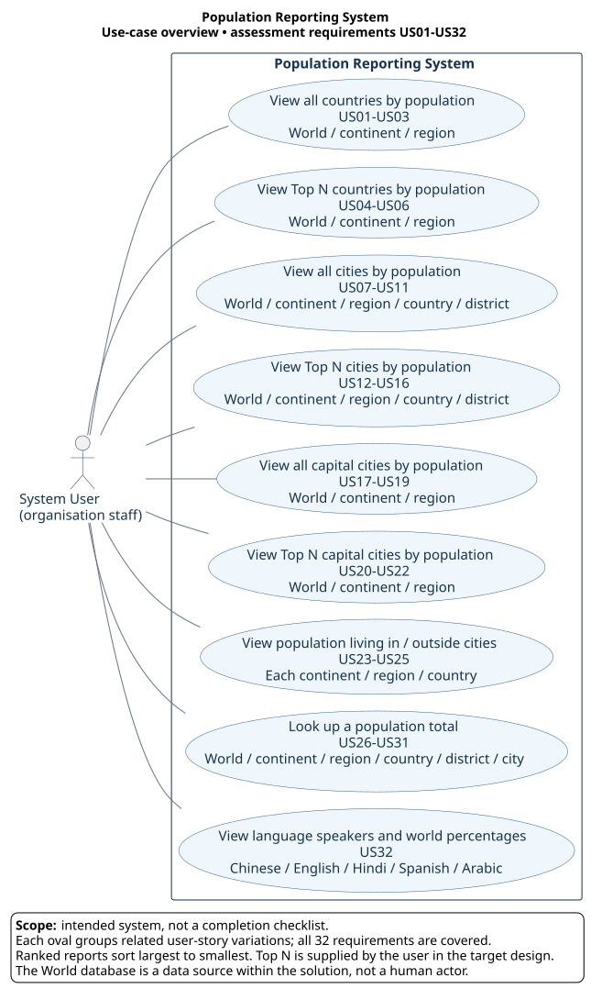

# Population Reporting System use-case diagram



[Download PNG](population-reporting-system.png) · [Editable PlantUML source](population-reporting-system.puml)

## Reading the diagram

The **System User** is the organisation's staff member requesting population
information. The rectangle marks the system boundary; the ovals are the user's
reporting goals. A solid line means the user participates in that use case.
The diagram groups geographic variations to keep the complete system readable
on one diagram. It is a requirements model, not a workflow or implementation-status chart.

The World database supplies the data. It is treated as part of the solution,
so it is not shown as a separate actor. Maven, Docker, IntelliJ, and GitHub are
development/deployment tools rather than actors in the reporting use cases.
No `include` or `extend` relationships are needed: the reports are independently
requested goals, and filtering and sorting are steps within those goals.

## Requirement traceability

The numbering follows the order of the 32 requirements in the coursework
specification. US17–US31 are requirement identifiers here; this does not imply
that matching GitHub issues already exist.

| Diagram goal | Requirement mapping |
|---|---|
| All countries | US01 world; US02 continent; US03 region |
| Top N countries | US04 world; US05 continent; US06 region |
| All cities | US07 world; US08 continent; US09 region; US10 country; US11 district |
| Top N cities | US12 world; US13 continent; US14 region; US15 country; US16 district |
| All capital cities | US17 world; US18 continent; US19 region |
| Top N capital cities | US20 world; US21 continent; US22 region |
| Population in/outside cities | US23 each continent; US24 each region; US25 each country |
| Population total | US26 world; US27 continent; US28 region; US29 country; US30 district; US31 city |
| Language speakers | US32 Chinese, English, Hindi, Spanish, Arabic; ordered by estimated speakers with world percentages |

Ranked country, city, and capital-city reports sort by descending population.
Top N reports require the user to provide N. Geographic reports require a
selected scope. Population breakdown reports show totals and both the counts
and percentages living in and outside cities.

## Implementation status on 14 October 2026

- Language reporting is implemented and verified.
- All ten city SQL variations are connected to Java and verified. Geographic
  filters are currently fixed and Top N currently means 10; configurable input
  remains to be implemented.
- The country demonstration currently prints only the Top 10 country names and
  populations. The full country report requires code, name, continent, region,
  population, and capital, as well as the requested geographic and N variations.
- Capital-city reports, population breakdowns, and population-total lookups
  are target requirements, not verified implementations in the current Java app.

The existing city use-case document on the team's `feature/city-use-cases`
branch describes US07–US16. This overview complements that narrative; it does
not replace detailed use-case scenarios or claim they are all complete.

## Code review explanation

“The staff member is our primary actor. Inside the system boundary are nine
reporting goals covering the 32 requirements. We group geographic variations
instead of repeating an oval for each one. The diagram shows the intended
system; implementation progress is tracked separately in the backlog.”

## Sources and editing

- [Coursework specification](https://github.com/Kevin-Sim/SET09803-DevOps-Global-Online/blob/master/assessment/README.md)
- [Lab 03b: use cases and PlantUML](https://github.com/Kevin-Sim/SET09803-DevOps-Global-Online/blob/master/labs/lab03b/README.md)

Edit the `.puml` file and regenerate both images using PlantUML. The source uses
PlantUML's Smetana layout engine, so no separate Graphviz installation is needed.
Rendered locally with PlantUML 1.2025.4:

```sh
java -jar plantuml.jar -tsvg population-reporting-system.puml
java -jar plantuml.jar -tpng population-reporting-system.puml
```
